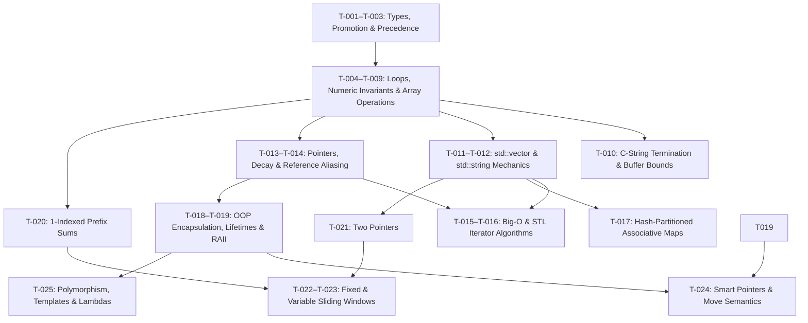

# Layer 2 — C++ Cognitive State Ledger
- **Document ID:** `CPP_COGNITIVE_STATE_LEDGER.md`
- **Target Audience:** Zero-context Principal Systems Architect or fresh AI instance
- **Governing Protocol:** Master C++ Learning Audit & Cognitive State Serialization Protocol (Part C — Layer 2)

---

## Table of Contents

- [C0.1 — Provenance Statement](#c01-provenance-statement)
- [C1 — Ontological Baseline & State Serialization](#c1-ontological-baseline--state-serialization)
  - [C1.1 — Domain Map](#c11-domain-map)
  - [C1.2 — Conceptual Topology & Load-Bearing Prerequisites](#c12-conceptual-topology--load-bearing-prerequisites)
  - [C1.3 — Evolutionary Arc](#c13-evolutionary-arc-systems-engineering-narrative)
  - [C1.4 — State Vector](#c14-state-vector-topic-level-cognitive-serialization)
  - [C1.5 — Active and Pending State Separation](#c15-active-and-pending-state-separation)
- [C2 — The Antifragile Layer](#c2-the-antifragile-layer-validated-competencies--cognitive-strengths)
- [C3 — Forensic Error Taxonomy & Vulnerability Deconstruction](#c3-forensic-error-taxonomy--vulnerability-deconstruction)
- [C4 — Deep Architectural & Methodological Exegesis](#c4-deep-architectural--methodological-exegesis)
- [C5 — Adversarial Stress-Testing & Edge-Case Horizons](#c5-adversarial-stress-testing--edge-case-horizons)
- [C6 — Remediation & Grandmaster Transformation Protocol](#c6-remediation--grandmaster-transformation-protocol)
- [C7 — Retention and Transfer Probe Design](#c7-retention-and-transfer-probe-design)
- [C8 — Machine-Readable State Block](#c8-machine-readable-state-block)
- [C9 — Confidence and Falsification Register](#c9-confidence-and-falsification-register)
- [C10 — Evidence Appendix (Traceability Map)](#c10-evidence-appendix-traceability-map)

---

## C0.1 Provenance Statement

1. **Generation Date & Audit Window:** Generated on `2026-11-11`. The audit covers the learning and assessment trajectory from the Phase 1–2 repository baseline through Stage 9, Module 9.1 (Task 2).

2. **Accessible vs. Inaccessible Evidence Sources:**
   - **Directly Inspected (`[A]`):** Verbatim conversation history, problem prompts, learner explanations, paper dry-runs, debugging analyses, and C++17 submissions spanning Stage 3 (Modules 3.1–3.2) through Stage 9 (Module 9.1, Task 2), including evidence artifacts `E-001` through `E-041` and spaced-repetition checks `R-001` through `R-008`.
   - **Summary-Preserved (`[C]`):** Phase 1 repository audit metrics (206 archive entries and 35 cataloged defects), the Phase 2 initial diagnostic baseline, and Stage 1–2 exercise scores (`E-000A` through `E-000K`). These pre-date the verbatim message window but are preserved in learning-state summaries and are corroborated in part by later recall probes (`R-001` through `R-004`).
   - **Unavailable / Not Yet Assessed (`[E]`):** Verbatim code transcripts for Stage 1–2 coding problems `#1–#6`; multi-week delayed-retention measurements (`>= 7 days`); Stage 9.1 implementation tasks (Tasks 3–4, explicitly deferred before formal theoretical instruction); Stage 9.2; and Stage 10.

3. **Distribution of Conclusions by Evidence Class (as reported in the audit):**
   - **Class `A` (Directly Demonstrated in Code, Trace, or Prose):** 49 evidence artifacts (`E-001` through `E-041` and `R-001` through `R-008`); 22 of 25 topic competence ratings (`T-001` through `T-023`, with sub-skill evidence for `T-005` split across evidence classes); all five validated cognitive strengths (`S-001` through `S-005`); and all 19 forensic error records (`M-001` through `M-019`).
   - **Class `B` (Assessment-Supported Without Multi-Week Delay):** 12 immediate-mastery topic ratings awaiting longer-spaced verification, as classified in the source ledger. Evidence classes describe different properties and may overlap; these counts should not be summed as mutually exclusive categories.
   - **Class `C` (Summary-Reported):** 11 historical baseline artifacts (`E-000A` through `E-000K`) and standalone number-theory sub-skills within `T-005`.
   - **Class `D` (Inferred Projections):** Second-order systemic ripples, third-order scale-failure scenarios, strength fragility tests, and adversarial stress horizons in Sections C2, C3, and C5. These are projections, not observed learner failures.
   - **Class `E` (Not Yet Assessed):** Deferred or unstudied work in `T-024` (formal theory and coding) and `T-025`; medium-/long-term retention across Stages 1–8; and four systems-level stress horizons.

4. **Known Fidelity Limitations:** The directly observed sessions occurred within a compressed, high-intensity learning window. Short-interval recall (`R-001` through `R-008`) is established by the available evidence, whereas resistance to multi-week forgetting remains unmeasured (`[E]`) and must be evaluated using the delayed-probe schedule in Section C7.

---

## C1. Ontological Baseline & State Serialization

### C1.1 Domain Map

The learner's technical trajectory spans seven interlocking systems-programming domains:

1. **Type Semantics, Scalar Representation & Operator Binding (`T-001`, `T-002`, `T-003`):** Deterministic value initialization with `{}`, explicit floating-point promotion using `static_cast<double>` before division, and operator-precedence distinctions among logical conjunction (`&&`), disjunction (`||`), and assignment (`=`).
2. **Iterative State Machines & Numeric Invariants (`T-004`, `T-005`, `T-008`, `T-009`):** Single-pass extremum and streak maintenance, sentinel-terminated stream processing, radix-10 digit decomposition (`% 10`, `/ 10`), and symmetric index reflection (`i` versus `N - 1 - i`) with the `N / 2` reversal bound.
3. **Contiguous Memory Topologies, Strings & Indirection (`T-006`, `T-007`, `T-010`, `T-011`, `T-012`, `T-013`, `T-014`):** Two-dimensional matrix indexing and multiplication, null-terminated C-string buffer bounds, `std::vector` value semantics, `std::string` search and character handling, lvalue-reference aliasing (`T&`, `const T&`), array-to-pointer decay, and scaled pointer arithmetic (`*(p + i)`).
4. **Asymptotic Complexity & Generic STL Abstractions (`T-015`, `T-016`):** Dominant-term growth analysis, auxiliary-space accounting, iterator-range algorithms (`std::sort`, `std::accumulate`, `std::max_element`), and strict weak ordering in custom comparators.
5. **Hash-Partitioned Associative Containers (`T-017`):** Average-case constant-time key lookup and insertion with `std::unordered_map`, the semantic difference between mutating `operator[]` and non-mutating `.count()` / `.find()`, frequency histograms, and single-pass complement lookup.
6. **Object-Oriented Encapsulation & Deterministic Lifetimes (`T-018`, `T-019`, `T-024`):** `private` state and `public` interfaces, constructor member-initializer lists, out-of-line scope resolution (`Class::method`), scoped LIFO destructor sequencing (`~Class()`), RAII, and the deferred study of exclusive heap ownership (`std::unique_ptr`, `std::move`).
7. **Linear-Time Subarray & Sequence Paradigms (`T-020`, `T-021`, `T-022`, `T-023`):** One-indexed cumulative prefix structures for constant-time range differences, converging and slow/fast two-pointer techniques, and fixed-/variable-width sliding-window state machines.

---

### C1.2 Conceptual Topology & Load-Bearing Prerequisites

The studied domains form a dependency structure. The graph below is a conceptual learning map, not a claim that every arrow is a strict formal prerequisite.



- **Load-Bearing Prerequisite 1 — Value, Copy & Reference Semantics (`T-011`, `T-014`):** Governs range-based loop mutation (`auto&` versus `auto`), non-copying parameter passing (`const T&`), comparator signatures (`T-016`), and the later comparison with move semantics (`T-024`).
- **Load-Bearing Prerequisite 2 — Loop Invariants & State-Transition Ordering (`T-004`):** Underpins second-extremum tracking (`T-009`), check-before-insert complement hashing (`T-017`), one-indexed prefix accumulation (`T-020`), and add/evict/observe sequencing in sliding windows (`T-022`, `T-023`).
- **Load-Bearing Prerequisite 3 — Deterministic Scoped Destruction (`T-019`):** Provides the foundation for RAII wrappers, automatic resource cleanup by `std::unique_ptr` (`T-024`), and later exception-safe resource management.

---

### C1.3 Evolutionary Arc (Systems-Engineering Narrative)

The learner's documented trajectory traversed four broad learning phases:

1. **Phase I — Fragmented Syntax & Passive-Recognition Baseline:** At the initial diagnostic baseline, the learner had working familiarity with scalar loops and basic array indexing (`T-001`–`T-008`), but showed substantial conceptual gaps at four structural boundaries: (a) predicting whether container assignment performed an independent value copy or shared access (`T-011`); (b) tracing array-to-pointer decay and scaled pointer arithmetic (`T-013`); (c) tracing OOP constructor/destructor lifecycles (`T-018`, `T-019`); and (d) recognizing the silent insertion behavior of `std::unordered_map::operator[]` (`T-017`). Earlier algorithmic exposure had also included reliance on externally generated solutions, creating a risk of recognition without independent solution generation.
2. **Phase II — Indirection, Memory-Model & Lifecycle Reconstruction (`E-007B` to `E-017`, `E-028` to `E-032`):** By grounding `std::vector` in its value semantics and distinguishing copies from reference aliases, the learner reached accurate traces and implementations for container mutations and pointer arithmetic (`E-007B`–`E-016`). This concrete memory model supported subsequent work on OOP encapsulation and LIFO destruction order (`E-028`–`E-032`), followed by a first-attempt 96% result on the multi-metric telemetry project (`E-017`).
3. **Phase III — Metacognitive Inflection Points: Reducing Template Dependence in `T-017` and `T-023`:**
   - **Inflection Point A (`T-017`, `E-022`–`E-027`):** After guided hash-map tasks, the learner voluntarily paused progression and disclosed reliance on inline scaffolding and remembered `twoSum` structures rather than a fully independent understanding of `.count()` and insertion ordering (`S-002`, `M-011`). Deconstructing key-existence checks and the query-before-mutate invariant was followed by unassisted transfer implementations (`E-025`, `E-026`) with reported 100% accuracy.
   - **Inflection Point B (`T-023`, `E-038A`–`E-039A`):** When moving from a minimum-length window with a lower-bound validity condition to a maximum-length window with an upper-bound constraint, template transfer caused an invariant-placement error (`M-016`). A paper state trace clarified where the valid window should be measured, followed by successful remediated implementations (`E-038B`–`E-038D`).
4. **Phase IV — Multi-Paradigm Architectural Synthesis & Boundary Calibration (`E-039`–`E-041`):** In the `TrafficAnalyzer` project (`E-039`), the learner integrated OOP state, one-indexed prefix sums, fixed-size sliding windows, and hash-map mode detection on the first attempt, scoring 90%. The attempt exposed terminal-boundary defects (`M-018`, `M-019`), both of which were repaired and verified in `E-040` (100%). The learner then completed an output-prediction trace involving `std::unique_ptr` and `std::move` (`E-041`), while formal theory and implementation remained deferred.

---

### C1.4 State Vector (Topic-Level Cognitive Serialization)

| Topic ID | Topic | Competence / Study Status | Evidence Class | Retention Status |
| :--- | :--- | :--- | :---: | :--- |
| T-001 | Data Types, Brace Initialization `{}` & Uninitialized Undefined Behavior | Mastered — Immediate Assessment | A | Short-interval application reported; multi-week retention unverified |
| T-002 | Explicit Type Promotion (`static_cast<double>`) | Mastered — Immediate Assessment | A | Retained — Short-Interval Recall (`R-001`) |
| T-003 | Operator Precedence (`=`, `&&`, `||`) & Short-Circuiting | Proficient — Remediated `M-001` | A | Retained after short-interval recheck (`R-003`); delayed verification pending |
| T-004 | Loop Invariants, Streak Tracking & Sentinel Loops | Mastered — Immediate Assessment | A/C | Short-interval application in Project #1 (`E-017`) |
| T-005 | Digit Extraction (`% 10`, `/ 10`) & Numeric Loops | Proficient — Digit arithmetic `[A]`; GCD/primes summary-reported `[C]` | A/C | Short-interval recall of digit arithmetic (`R-004`); GCD/primes not separately reverified |
| T-006 | 2D Matrix Traversal & Main-Diagonal Optimization | Mastered — Immediate Assessment | A | Needs Delayed Verification |
| T-007 | 2D Matrix Multiplication (Three-Loop `i, j, k`) | Practiced — Needs Revision (`M-004`, `M-006`) | A | Needs Revision; independent repair probe `R-015` pending |
| T-008 | In-Place Array Reversal (`i < n / 2`) | Mastered — Immediate Assessment | A | Retained — Short-Interval Recall (`R-005`) |
| T-009 | Single-Pass Second-Largest Invariant (`INT_MIN`) | Mastered — Immediate Assessment after remediation of `M-003` | A | Retained — Short-Interval Recall (`R-005`) |
| T-010 | C-String Null Termination & Buffer Bounds | Understood; OS-memory distinction clarified (`M-002`) | A | Needs Delayed Verification |
| T-011 | `std::vector` Value Semantics vs. Reference Iteration | Mastered — Immediate Assessment | A | Retained through later cross-module application |
| T-012 | `std::string` Search (`.find`, `npos`) & `<cctype>` | Mastered — Immediate Assessment | A | Retained through Project #1 application (`E-017`) |
| T-013 | Pointers (`*`, `&`), Array-to-Pointer Decay & Pointer Arithmetic | Mastered — Immediate Assessment | A | Needs Delayed Verification (`R-010`) |
| T-014 | Parameter Passing Modes (`T`, `T&`, `const T&`) | Mastered — Immediate Assessment | A | Retained — Short-Interval Recall |
| T-015 | Asymptotic Time & Space Dominance Analysis | Mastered — Immediate Assessment after remediation of `M-010` | A | Retained — Short-Interval Recall (`R-006`) |
| T-016 | Generic STL Algorithms & Strict Weak Comparators | Mastered — Immediate Assessment | A | Needs Delayed Verification (`R-011`) |
| T-017 | Hash Table Lookup vs. Insertion & Frequency State | Mastered — Immediate Assessment | A | Retained — Short-Interval Recall (`R-007`, `E-040`) |
| T-018 | OOP Encapsulation, Initializer Lists & Scope Resolution (`::`) | Mastered — Immediate Assessment | A | Retained — Short-Interval Recall (`E-040`) |
| T-019 | Scoped LIFO Destructor Sequencing & RAII | Mastered — Immediate Assessment | A | Needs Delayed Verification (`R-012`) |
| T-020 | One-Indexed Prefix Sums & `O(1)` Range Differences | Mastered — Immediate Assessment after remediation of `M-018` | A | Short-interval verification/application (`R-008`, `R-014`); multi-week retention pending |
| T-021 | Converging & Slow/Fast Two-Pointer Compaction | Mastered — Immediate Assessment | A | Needs Delayed Verification |
| T-022 | Fixed-Size Sliding-Window Incremental State | Mastered — Immediate Assessment after remediation of `M-019` | A | Immediate consolidation in Project #2 (`E-040`); delayed verification pending |
| T-023 | Variable-Size Monotonic Sliding Window | Proficient — Remediated `M-015` and `M-016` | A | Needs Delayed Verification (`R-013`) |
| T-024 | Smart Pointers (`std::unique_ptr`) & Move Semantics | Studied — Output trace only; theory and coding deferred | A/E | Not Yet Assessed for theory/coding or delayed retention |
| T-025 | Polymorphism, Templates & Lambda Expressions | Not Studied | E | Not Yet Assessed |

### **C1.5 Active and Pending State Separation**

> * **Completed & Verified ([A]):** T-001 through T-023 (excluding standalone repair of T-007), plus multi-module synthesis artifacts E-017 and E-040.  
> * **Paused / Partially Completed ([A] / [E]):** T-024 — Ownership transfer trace (E-041) completed at 100%; debugging analysis and class implementation with std::unique_ptr explicitly deferred by the operator prior to formal theoretical study.  
> * **Pending / Unstudied ([E]):** T-025 (Inheritance, virtual dispatch, generic templates, lambda closures) and the final capstone architecture project.

## **C2. The Antifragile Layer (Validated Competencies & Cognitive Strengths)**

### **S-001 — Dimensionality Reduction & Index-Offset Algebraic Instinct**

> * **Mechanism:** A two-dimensional square matrix M \in \mathbb{R}^{N \times N} stores its main diagonal along the locus of coordinates (r, c) where r = c. A naive traversal iterates over the Cartesian product \{0 \dots N-1\} \times \{0 \dots N-1\} and filters with a conditional branch (if (r == c)), expending \Theta(N^2) comparisons and branch predictions. Restricting the index generator to the parametric line (i, i) collapses the iteration space to \Theta(N) with zero branches. Similarly, in a 1-indexed cumulative array P, a fixed window of width K starting at l has its right boundary fixed at r = l + K, reducing a two-variable range query to a constant-offset pointer pair.  
> * **Mental Model:** The operator views container indices not merely as loop counters, but as algebraic coordinates that can be coupled (mat[i][i], scores.begin() + 1 to scores.end() - 1, right = left + k) to bypass redundant states (E-002, E-019, E-034) [A].  
> * **Independence Level:** **Implemented Independently** (fluency-grade: generated spontaneously on first attempt without hints).  
> * **Theory Alignment vs. Pattern Matching:** Genuine structural insight [A]. In E-019, rather than summing the entire array and subtracting extrema in extra variables, the operator directly restricted the iterator range [begin() + 1, end() - 1) passed to std::accumulate.  
> * **Scaling Path:** Extends directly to O(N) anti-diagonal traversal (mat[i][N - 1 - i]), binary-indexed tree (Fenwick) offset jumping (i += i & -i), and 2D prefix-sum inclusion-exclusion geometry.  
> * **Fragility Test ([D — Inferred]):** Will fail on **non-square (rectangular or jagged) 2D matrices** (R \times C where R > C) if the single loop runs to i < mat.size() without bounding against min(mat.size(), mat[i].size()), triggering an out-of-bounds access on column i when i \ge C.

### **S-002 — Epistemic Self-Auditing & Anti-Illusion Calibration**

> * **Mechanism:** Cognitive learning in algorithmic programming frequently suffers from *recognition-recall dissociation*: a learner who can trace or reproduce a recently viewed code block mistakes working-memory familiarity for procedural competence. Detecting this dissociation requires monitoring whether each line of code is generated from an underlying state invariant or from visual recall of a template.  
> * **Mental Model:** The operator explicitly separates *"my code compiles and passes the test"* from *"I can derive this invariant without scaffolding"* (E-022, E-024, E-037, E-038A) [A].  
> * **Independence Level:** **Self-Initiated Metacognitive Regulation**.  
> * **Theory Alignment vs. Pattern Matching:** High calibration accuracy [A]. When the operator reported template reliance in E-038A, forensic inspection confirmed a latent invariant flaw (M-016) that would have gone unnoticed on degenerate inputs.  
> * **Scaling Path:** Crucial for complex system debugging, security auditing, and invariant verification where superficial test passes mask subtle state corruption.  
> * **Fragility Test ([D — Inferred]):** Under high time pressure or competitive comparison anxiety (documented in E-027), epistemic self-auditing can tip into **impostor-driven under-confidence**, causing the operator to doubt valid, original derivations (E-025, E-026).

### **S-003 — Associative State Decomposition (Frequency & Complement Projections)**

> * **Mechanism:** Given an unsorted sequence A = [a_0, a_1, \dots, a_{N-1}], pairwise relation queries of the form f(a_i, a_j) = \text{true} for i < j require \Theta(N^2) comparisons under stateless scanning. By projecting each prefix element a_i into a hash-partitioned set/map H in \Theta(1) expected time, the query at index j is reduced to checking whether the inverse element f^{-1}(a_j) belongs to H, achieving \Theta(N) expected time at the cost of \Theta(N) auxiliary space.  
> * **Mental Model:** Following remediation of M-011, the operator models a hash table as a two-part contract: (1) a frequency accumulator (H[k]++) for cardinality queries, or (2) a historical lookback ledger where existence is tested via .count(inverse) > 0 *prior* to state insertion (E-025, E-026, E-027, E-040) [A].  
> * **Independence Level:** **Adapted to Novel Problems** (fluent on primitive keys/values).  
> * **Scaling Path:** Prefix-sum modulo hashing (P_j \equiv P_i \pmod K), memoization tables in top-down dynamic programming, and adjacency-list graph representations (unordered_map<int, vector<int>>).  
> * **Fragility Test ([D — Inferred]):** Vulnerable to (1) **adversarial hash-collision inputs** that degrade std::unordered_map from \Theta(1) average to \Theta(N) per operation (\Theta(N^2) total) unless reserve() and a custom splitmix64 hash are supplied, and (2) **multi-set cardinality requirements** where deleting or decrementing a single instance of a key (freq[k]--) leaves a zero-valued key active in the map (freq.count(k) remains 1 even when freq[k] == 0!).

### **S-004 — Deterministic Execution-Stack & Memory-Indirection Simulation**

> * **Mechanism:** Executing a C++ program constructs a LIFO call stack of activation records. Value variables allocate independent storage within their frame; references (T&) bind an alternative identifier to an existing lvalue address; pointers (T*) store raw virtual addresses scaled by sizeof(T) under addition; and automatic objects invoke their destructor (~T()) deterministically at the closing lexical brace } in exact reverse order of construction.  
> * **Mental Model:** The operator maintains an explicit mental table mapping identifiers to either independent storage blocks or aliased addresses, and tracks scope entry/exit as a strict LIFO stack (E-007B, E-014, E-030, E-041) [A].  
> * **Independence Level:** **Implemented & Traced Independently** with fluency.  
> * **Scaling Path:** Direct foundation for smart-pointer RAII chains (std::unique_ptr), exception-unwinding stack safety, and lock-guard concurrency primitives (std::lock_guard<std::mutex>).  
> * **Fragility Test ([D — Inferred]):** Will fail when **container reallocation invalidates pointers/references/iterators**—for example, holding int *p = &v[0]; or auto &ref = v[0]; across a v.push_back(x) call that exceeds v.capacity(), leaving p and ref dangling into freed heap memory.

### **S-005 — Encapsulated Type Architecture & Member Initialization Discipline**

> * **Mechanism:** An object-oriented class defines a user-defined type whose representation is hidden (private) and manipulated solely through public operations that preserve structural invariants. Initializing data members via the constructor member initializer list (: m_a(a), m_b(b)) constructs sub-objects directly in a single step rather than default-constructing and copy-assigning them inside the constructor body.  
> * **Mental Model:** The operator treats a class as a self-contained module with private state vectors, constructor precomputation, and const-qualified query methods (E-028, E-029, E-032, E-033, E-040) [A].  
> * **Independence Level:** **Implemented Independently**.  
> * **Scaling Path:** Rule of Zero/Five resource-managing classes, polymorphic interfaces, and template policy classes.  
> * **Fragility Test ([D — Inferred]):** Vulnerable to **Member Initializer List Declaration-Order Inversion**: in C++, members are initialized in the exact order they are **declared inside the class body**, *not* the order written in the constructor's : b(val), a(b) initializer list. If a class declares vector<int> prefix; *above* vector<int> packets; and writes : packets(data), prefix(packets.size() + 1, 0), prefix is initialized first using an unconstructed packets vector (Undefined Behavior)!

## **C3. Forensic Error Taxonomy & Vulnerability Deconstruction**

All 19 documented mistakes (M-001 through M-019) are categorized below by universal failure class. Taxonomy classes from the master table with zero observed instances in the evidence (**Copy / Alias Semantics**—which was resolved immediately after the initial diagnostic baseline—and **Ownership & Lifetime Errors**—which has not yet been assessed in code) are explicitly noted as having zero post-diagnostic occurrences.

### **Class 1: Update-Ordering Fault**

> * **Definition & Universal Principle:** Performing valid state-mutation and state-observation operations in an inverted temporal sequence within an iterative step. **Universal Principle:** *Every statement inside a loop body sits either BEFORE the state transition (observing state S_{t-1}) or AFTER the state transition (observing state S_t). A query that requires historical exclusivity must precede mutation; an aggregation that requires current-step completeness must follow mutation.*  
> * **Documented Instances:**  
  * M-011 (E-023, T-017): Inserting current element a_i into the lookup table prior to querying for its complement T - a_i, causing reflexive self-matching when 2a_i = T [A].  
  * M-019 (E-039, T-022): Updating the running maximum maxSum = max(maxSum, currentSum) prior to sliding the window sum currentSum += A[i] - A[i - k], causing the final window state at i = N - 1 to be computed and discarded upon loop exit [A].  
> * **Multi-Order Causal Chain:**  
  * **0th Order (Epistemic Root):** Viewing a loop body as an unordered bag of required operations (*"inside this loop I need to update currentSum and update maxSum"*), rather than a sequential state-transition edge S_{t-1} \xrightarrow{\text{transition}} S_t \xrightarrow{\text{observe}} \text{Record}(S_t) [A].  
  * **1st Order (Immediate Manifestation):** In E-023, input [3, 2, 4] with target 6 returned [0, 0]; in E-039, input [10, 20, 10, 40, 30, 10, 50] with k = 3 returned 80 instead of the true final-window maximum 90 [A].  
  * **2nd Order (Systemic Ripple [D — Inferred]):** Creates "interior-passing, boundary-failing" implementations that pass all test cases where the optimum lies in the middle of the array [1 .. N-2], breeding false confidence while failing whenever the unique answer involves index 0 or index N - 1.  
  * **3rd Order (Scale Failure Mode [D — Inferred]):** In a real-time financial risk engine or network intrusion detector (TrafficAnalyzer), an update-ordering fault on the trailing window edge causes a spike occurring in the final packet burst of an epoch to be silently dropped from peak-load telemetry, preventing rate-limiting triggers from firing.  
> * **Closing Protocol:**  
  1. **Detection Signature:** Any loop where the accumulator/extremum (maxVal, minVal, seen) is read or updated *above* the line that advances the current step's state (currentSum += ...).  
  2. **Prevention Invariant:** Enforce the **Transition-Then-Observe Contract** for inclusive aggregations (mutate state -> validate invariant -> record extremum), and the **Observe-Then-Register Contract** for strictly historical lookbacks (query history -> register current item in history).  
  3. **Verification Test:** Trace a 2-window array [10, 10, 10, 99] with k = 3 where the maximum is strictly at the final index.  
> * **Recurrence & Diagnosis:** Occurred twice across distinct domains (T-017 and T-022); diagnosed as a **habit/verification gap** (failure to dry-run i = N - 1), now **Resolved (Verified [A] in E-026 and E-040)**.

### **Class 2: Initialization & Finalization Gaps**

> * **Definition & Universal Principle:** Failing to establish the pre-loop seed state or failing to flush/translate the post-loop terminal state before returning to the caller. **Universal Principle:** *A loop of N transitions connects N + 1 fencepost states; both the initial seed (t = 0) and the terminal flush/sentinel translation (t = N) must be explicitly accounted for outside the N-step transition body.*  
> * **Documented Instances:**  
  * M-003 (E-005, T-009): Returning internal sentinel INT_MIN directly instead of -1 when no distinct second-largest element exists [A].  
  * M-015 (E-037B, T-023): Returning internal sentinel nums.size() + 1 directly instead of 0 when no subarray sum reaches target [A].  
  * M-018 (E-039, T-020): Executing prefix.push_back(sum); sum += n; inside an N-iteration loop without pushing the final accumulated sum after loop termination, producing a prefix table of length N instead of N + 1 [A].  
> * **Multi-Order Causal Chain:**  
  * **0th Order (Epistemic Root):** Cognitive closure upon finishing the primary for loop body—treating the closing brace } of the loop as the end of the algorithm rather than auditing the post-loop invariant [A].  
  * **1st Order (Immediate Manifestation):** Leakage of INT_MIN (-2147483648) in E-005, leakage of N + 1 in E-037B, and missing terminal element prefix[N] in E-039 [A].  
  * **2nd Order (Systemic Ripple [D — Inferred]):** Callers of getRangeTraffic(left, N - 1) in E-039 trigger an unhandled std::out_of_range exception whenever a query touches the last element of the dataset.  
  * **3rd Order (Scale Failure Mode [D — Inferred]):** If a downstream system consumes the leaked sentinel (nums.size() + 1 or INT_MIN) as a valid physical quantity (e.g., allocating a buffer or computing a billing rate from secondLargest), it triggers massive arithmetic underflow or out-of-bounds memory allocation.  
> * **Closing Protocol:**  
  1. **Detection Signature:** Any function that initializes a variable to an impossible sentinel (INT_MIN, INT_MAX, N + 1) and ends with an unconditional return var;, or any (N+1)-sized structure populated inside an N-step loop without a pre-loop or post-loop seed.  
  2. **Prevention Invariant:** **The Fencepost & Sentinel Pairing Rule:** The exact instant a sentinel is declared (int ans = SENTINEL;), write the exit translation (return (ans == SENTINEL) ? FALLBACK : ans;) *before* writing the loop.  
  3. **Verification Test:** Probe R-014 (1-indexed prefix sum construction verified at .back()) and all-equal / unreachable-target edge inputs.  
> * **Recurrence & Diagnosis:** Repeated across Stages 3.2 and 8.3; diagnosed as an **attention/verification gap at function exit**, now **Resolved (Verified [A] in E-038D and E-040)**.

### **Class 3: Invariant Misalignment**

> * **Definition & Universal Principle:** Placing a state-measurement operation inside a conditional block whose guard represents the *violation* of the target invariant rather than its satisfaction. **Universal Principle:** *An observable metric M may only be sampled at a program point P where the logical Hoare assertion \{ \text{Invariant}(S) \} is guaranteed to hold.*  
> * **Documented Instance:**  
  * M-016 (E-038A, T-023): Placing maxLen = max(maxLen, i - left + 1); *inside* while (currentSum > budget) when computing the longest subarray with sum \le \text{budget} [A].  
> * **Multi-Order Causal Chain:**  
  * **0th Order (Epistemic Root):** Structural anchoring on a previously seen template (minSubArrayLen, where the while (currentSum >= target) loop body executes while the window is *valid*) and transferring the syntactic shell to an inverted constraint without re-evaluating whether the while guard represents validity or invalidity [A].  
  * **1st Order (Immediate Manifestation):** Whenever the window remained within budget (currentSum <= budget), the while loop was bypassed and maxLen remained 0; when the window exceeded the budget, maxLen was measured mid-shrink before validity was necessariamente restored [A].  
  * **2nd Order (Systemic Ripple [D — Inferred]):** Complete breakdown when facing any problem that flips a minimization condition (\ge K) to a maximization condition (\le K).  
  * **3rd Order (Scale Failure Mode [D — Inferred]):** In a packet admission controller, sampling window capacity only during congestion-drop events reports 0 utilization during normal traffic and records invalid over-capacity bursts as legal baselines.  
> * **Closing Protocol:**  
  1. **Detection Signature:** Updating a maxLen or count variable inside a while (invalid_condition) recovery loop.  
  2. **Prevention Invariant:** Write an explicit comment at the measurement line: // ASSERT: Window [left..i] is now VALID.  
  3. **Verification Test:** Probe R-013 (longestOnesWithAtMostKZeros).  
> * **Recurrence & Diagnosis:** Occurred once during initial exposure to variable windows; diagnosed as **template-anchoring under unfamiliarity**, now **Resolved (Verified [A] in E-038B and E-039A)**.

### **Class 4: Syntactic vs Semantic Confusion**

> * **Definition & Universal Principle:** Writing code or mathematical notation that is syntactically legal (compiles without error) but means something fundamentally different in the language's execution semantics.  
> * **Documented Instances:**  
  * M-001 (R-002, T-003): Reading vip = true && level >= 5 left-to-right as (vip = true) && ... instead of vip = (true && (level >= 5)) [A].  
  * M-005 (E-007, T-003): Using bitwise & instead of logical && in (i == 0 & j == 0) [A].  
  * M-012 (E-024, T-017): Returning frequency tally max (n.second) instead of element key best (n.first) at the end of findMostFrequent [A].  
  * M-017 (E-038C, T-023): Writing i = nums.at(0) = 3 in prose explanation, conflating index coordinate i with element value nums[i] [A].  
> * **Multi-Order Causal Chain:**  
  * **0th Order (Epistemic Root):** Natural-language reading heuristics overriding formal C++ operator binding and type-role distinctions [A].  
  * **1st Order (Immediate Manifestation):** Wrong boolean state (1 vs 0 in R-002), wrong return value (3 vs 40 in E-024) [A].  
  * **2nd Order (Systemic Ripple [D — Inferred]):** Subtle logic bugs that pass compiler checks without warnings unless -Wall -Wextra -Wparentheses is enabled.  
  * **3rd Order (Scale Failure Mode [D — Inferred]):** Using bitwise & in place of && inside a pointer guard (if (ptr != nullptr & *ptr > 0)) eliminates short-circuit evaluation, dereferencing a null pointer and crashing the process with SIGSEGV.  
> * **Closing Protocol:**  
  1. **Detection Signature:** Unparenthesized mixed assignment/logical expressions (=, &&, ||), single & / | inside boolean conditions, or ambiguous variable names (max vs bestCount / bestKey).  
  2. **Prevention Invariant:** Parenthesize compound boolean assignments explicitly and name map variables by role (max_freq vs most_frequent_key).  
  3. **Verification Test:** Probe R-009.  
> * **Status:** **Resolved (Verified [A] in R-003, E-039A, E-040)**.

### **Class 5: Off-by-One / Index Semantics**

> * **Definition & Universal Principle:** Misaligning 0-based element indices (0 .. N-1), container dimensions (N), and 1-indexed prefix boundaries (0 .. N).  
> * **Documented Instances:**  
  * M-006 (E-007, T-007): Checking (i == 2) && (j == 2) on a 2 \times 2 matrix whose valid indices are 0 and 1 [A].  
  * M-014 (E-033A, T-020): Evaluating 1-indexed prefix range [4, 4] manually as prefix[4] - prefix[4] = 0 instead of prefix[5] - prefix[4] = 4 [A].  
> * **Multi-Order Causal Chain:**  
  * **0th Order (Epistemic Root):** Dropping the + 1 inclusive-to-half-open index translation ([left, right] \to [left, right + 1)) during rapid mental arithmetic [A].  
  * **1st Order (Immediate Manifestation):** Dead branch (i == 2) in E-007; zero sum for single-element range [4, 4] in E-033A [A].  
  * **2nd Order (Systemic Ripple [D — Inferred]):** Off-by-one boundary misses in range queries and matrix border checks.  
  * **3rd Order (Scale Failure Mode [D — Inferred]):** Accessing mat[N][N] on a raw C-array or std::vector::operator[] reads/writes unowned memory past the buffer.  
> * **Closing Protocol:**  
  1. **Detection Signature:** Any range query where left == right evaluates to 0 elements (prefix[r] - prefix[l]) or any index check i == N inside a loop bounded by i < N.  
  2. **Prevention Invariant:** Sanity-check every range formula on a 1-element interval [k, k]: the length must be k - k + 1 = 1, and the prefix difference must be P[k + 1] - P[k] = A[k].  
  3. **Verification Test:** Completed in R-008 (100% [A]).  
> * **Status:** **Resolved (Verified [A] in R-008)**.

### **Class 6: State-Mutation Blindness & Verification Failure**

> * **Definition & Universal Principle:** Instrumenting or tracing the wrong state variable during debugging (M-004: printing static input a[i][j] instead of accumulator c[i][j] inside the k loop; M-009: substituting argument 25 for initial value 100 in a trace).  
> * **Multi-Order Causal Chain:**  
  * **0th Order:** Focusing on loop structure while taking a mental shortcut on which variable holds the mutating state [A].  
  * **1st Order:** Misleading debug output in E-007 and trace slip in E-014B [A].  
  * **2nd Order ([D — Inferred]):** Wasted debugging cycles when instrumentation prints an invariant input rather than the corrupted accumulator.  
  * **3rd Order ([D — Inferred]):** Deploying a logging monitor in production that logs the request parameter rather than the mutated database state, hiding silent data corruption.  
> * **Closing Protocol:** Always verify debug print targets against hand-calculated 2x2 examples; **Status: Resolved ([A] in E-030, E-034, E-035)**.

### **Class 7: Abstraction Leakage, Type/Conversion, Algorithmic Analysis & Problem Interpretation**

> * **Instances:**  
  * M-002 (**Abstraction Leakage**, E-004): Assuming process stack overflow directly overwrites another separate application's RAM despite OS virtual memory isolation [A].  
  * M-013 (**Abstraction Leakage**, E-031): Exposing private state as public to silence a compile error rather than adding a setter [A].  
  * M-008 (**Type & Conversion Error**, E-013): Iterating over std::string characters with for (size_t c : s) instead of for (char c : s) [A].  
  * M-010 (**Algorithmic Inefficiency / Dominance Analysis**, E-018A): Reducing O(N + N \log N) to O(N) instead of O(N \log N) [A].  
  * M-007 (**Problem-Interpretation Error**, E-008): Subtracting the count of clamped negative elements from the denominator (nums.size() - count), conflating in-place clamping with element deletion and risking division by zero [A].  
> * **Multi-Order Causal Chain (Focusing on M-007 & M-010):**  
  * **0th Order:** Conflating domain operations (*clamp* \neq *filter*) in M-007; misapplying asymptotic simplification rules in M-010 [A].  
  * **1st Order:** Potential division by zero on all-negative arrays in E-008; incorrect complexity bound in E-018A [A].  
  * **2nd Order ([D — Inferred]):** Selecting an O(N \log N) sort when an O(N) pass exists if the operator believes O(N \log N) \equiv O(N).  
  * **3rd Order ([D — Inferred]):** Floating-point NaN / Inf propagation or hardware SIGFPE crash in telemetry aggregation when all incoming sensor readings are negative (count == nums.size()).  
> * **Closing Protocol:** Check denominator positivity (size > 0) and evaluate asymptotic terms at N = 2^{20}. **Status: Resolved (Verified [A] in E-017 and R-006)**.

### **Cross-Class Interaction Analysis (Where Systemic Risk Concentrates)**

The most dangerous compound vulnerability in the operator's profile is the interaction between **Update-Ordering Faults (Class 1)** and **Initialization & Finalization Gaps (Class 2)** at the **terminal boundary (i = N - 1)** (M-018 + M-019 in E-039) [A]. When a loop both delays state observation by one step (M-019) and omits post-loop finalization (M-018), every interior test case (0 < i < N - 1) passes while the final element of the container is systematically excluded from both cumulative queries and sliding-window extrema.

## **C4. Deep Architectural & Methodological Exegesis**

### **1. Loops as Deterministic Finite State Machines (T-004, T-009)**

Every imperative loop over a sequence A[0 \dots N-1] is a state machine transitioning from an initial state S_0 to a terminal state S_N via a transition function S_{i+1} = \delta(S_i, A[i]). Correctness rests entirely on a **Loop Invariant** \mathcal{I}(i): a predicate that holds before the first iteration (i = 0), is preserved by every transition (i \to i + 1), and implies the postcondition at termination (i = N).

> * *Illustrative Example (Single-Pass Second Extremum T-009):* To maintain the top two distinct values (L_1, L_2) across prefix A[0 \dots i-1], any incoming element x = A[i] induces a three-way state transition:  
>   `if (x > L1) {`  
>       `L2 = L1; // Demote previous champion BEFORE overwriting L1`  
>       `L1 = x;`  
>   `} else if (x < L1 && x > L2) {`  
>       `L2 = x;  // Strictly less than L1, strictly greater than L2`  
>   `}`  
>   Violating the assignment order (L1 = x; L2 = L1;) destroys historical state L_1, collapsing (L_1, L_2) into (x, x).

### **2. Cumulative Structures & Half-Open Geometry (T-020)**

Given an array A[0 \dots N-1], repeated range-sum queries \sum_{k=l}^{r} A[k] require \Theta(N) work per query if computed on demand (\Theta(Q \cdot N) for Q queries). Defining a 1-indexed cumulative array P[0 \dots N] of length N + 1 by:  
P[0] = 0, \qquad P[i + 1] = P[i] + A[i] \quad (0 \le i < N)  
establishes the invariant that P[k] equals the sum of the half-open prefix A[0 \dots k-1) (the first k elements). Consequently, the inclusive range [l, r] corresponds to the set difference [0, r+1) \setminus [0, l), yielding:  
\sum_{k=l}^{r} A[k] = P[r + 1] - P[l]  
in \Theta(1) time with zero conditional branching at l = 0. Using a 0-indexed prefix array of size N accumulates technical debt by forcing every query site to branch on if (l == 0) return P[r]; else return P[r] - P[l - 1];.

### **3. Incremental Window State Machines (T-022, T-023)**

> * **Fixed-Width Window (T-022):** A window of constant width K sliding from [i-K, i-1] to [i-K+1, i] shares K - 1 interior elements. Recomputing the sum from scratch performs K - 1 redundant additions. Updating incrementally via:  
>   `W += A[i] - A[i - K]; // Step 1: Transition state to [i - K + 1 .. i]`  
>   `best = std::max(best, W); // Step 2: Observe valid state W`  
>   decouples per-step cost from K, reducing \Theta(N \cdot K) to \Theta(N).  
> * **Variable-Width Monotonic Window (T-023):** When all elements A[i] \ge 0, the window sum W(l, r) = \sum_{k=l}^{r} A[k] is monotonically non-decreasing with r and monotonically non-increasing with l. This monotonicity allows two pointers (l, r) to find optimal subarrays in \Theta(N) amortized time (at most N increments of r and N increments of l):  
  * For **Maximization under Upper Bound (W \le B)**: advancing r may temporarily violate the bound (W > B). The inner while (W > B) loop restores validity by advancing l; measurement maxLen = max(maxLen, r - l + 1) **must occur after the while loop** where W \le B is restored (M-016).  
  * For **Minimization under Lower Bound (W \ge T)**: advancing r eventually achieves validity (W \ge T). The inner while (W >= T) loop records minLen = min(minLen, r - l + 1) **inside the loop** while attempting to shrink l further.

### **4. Hash-Partitioned Associative Memory (T-017)**

std::unordered_map<K, V> partitions the key universe across an array of buckets using b = \text{hash}(k) \bmod B, providing \Theta(1) expected lookup and insertion, degrading to \Theta(N) worst-case if all keys collide into a single linked bucket.

> * **Lookup vs. Insertion Asymmetry:** map[k] has signature V& operator[](const K& k). Because it must return a modifiable lvalue reference V& even when k is absent, it **must** insert {k, V{}} into the table when k is not found (E-021). Read-only existence or value queries on a potentially absent key must use map.count(k) or map.find(k), which preserve container immutability and permit const unordered_map<K, V>& parameter passing (E-022).

### **5. Memory Model, Deterministic Lifetimes & Ownership (T-011, T-013, T-018, T-019, T-024)**

> * **Stack vs. Heap & RAII:** Automatic objects reside in contiguous stack frames and are reclaimed via single-instruction stack-pointer adjustment after invoking ~T() in LIFO order (T-019). Heap allocations persist across scope boundaries until explicitly deallocated.  
> * **Shallow vs. Deep Copy & Double-Free:** A compiler-generated copy constructor performs a memberwise copy. If a class owns a raw heap pointer T* ptr, memberwise copying aliases both objects to the same heap address (**shallow copy**). When both objects exit scope, both destructors invoke delete ptr; on the same address (**double-free undefined behavior**).  
> * **Exclusive Ownership & Move Semantics (T-024):** std::unique_ptr<T> enforces a 1-to-1 ownership invariant by deleting its copy constructor (unique_ptr(const unique_ptr&) = delete) and providing a move constructor that copies the raw pointer and nulls the source pointer in \Theta(1) time (E-041). Critically, std::move(x) does **not** move anything itself: it is purely a compile-time static_cast<T&&>(x) (an rvalue-reference cast) that marks x as eligible to have its resources pilfered by a move constructor or move assignment operator.

## **C5. Adversarial Stress-Testing & Edge-Case Horizons**

**Epistemic Notice:** Per Protocol Rule A2.3 and Section C5, all stress-test failure mechanisms below are projections labelled **[D — Inferred]** designed to test the boundaries of the operator's demonstrated mental models.

### **1. Stress Test on T-023 (Variable Sliding Window): Negative Elements Breaking Monotonicity [D — Inferred]**

> * **Adversarial Scenario:** Pass costs = {4, -3, 4, 2} with budget = 5 into longestSubarrayWithinBudget (E-038B).  
> * **Predicted Failure Mechanism ([D — Inferred]):** The shrinking loop while (currentSum > budget) assumes that subtracting costs[left] and advancing left++ will *decrease* currentSum. When costs[left] is negative (-3), executing currentSum -= (-3) **increases** currentSum by +3, trapping the window or prematurely discarding valid longer subarrays that become \le \text{budget} after absorbing subsequent negative values.  
> * **Defensive Paradigm:** Assert precondition all_of(costs.begin(), costs.end(), [](int x){ return x >= 0; }) for two-pointer sliding windows; switch to **Prefix Sum + Monotonic Queue / Binary Search** when negative elements are permitted.  
> * **Verification Probe:** Feed into R-016 (Conceptual boundary check on when two-pointer sliding windows are valid vs invalid).

### **2. Stress Test on T-020 & T-022 (TrafficAnalyzer E-040): Signed Integer Overflow & Negative Window Width [D — Inferred]**

> * **Adversarial Scenario:**  
  1. Pass k = -2 or k = 0 into TrafficAnalyzer::getMaxWindowTraffic(int k) (E-040).  
  2. Pass packets = {INT_MAX, INT_MAX} into getMaxWindowTraffic(2).  
> * **Predicted Failure Mechanism ([D — Inferred]):**  
  1. **Signed-to-Unsigned Conversion Trap in if (packets.size() < k):** In E-040, packets.size() is an unsigned size_t (64-bit), whereas k is a signed int. In C++, comparing size_t < int implicitly converts int k to size_t! If a caller passes k = -1, k converts to SIZE_MAX (18446744073709551615), or if k = 0, the first loop runs 0 times, maxSum is 0, and the second loop (i = 0) accesses packets.at(0 - 0) instead of returning 0!  
  2. **Return Type Narrowing:** In E-040, currentSum and maxSum were wisely upgraded to long long, but the function return type remained int getMaxWindowTraffic(int k) const, silently narrowing long long maxSum back to 32-bit int at return maxSum;!  
> * **Defensive Paradigm:** Guard if (k <= 0 || static_cast<size_t>(k) > packets.size()) return 0; and match the return type (long long) to the accumulator type (long long).

### **3. Stress Test on T-017 (Hash Map Frequency Deletion): The Zero-Count Ghost Key [D — Inferred]**

> * **Adversarial Scenario:** Decrementing frequencies in a dynamic sliding window (freq[out_elem]--;) and checking if (freq.count(out_elem) > 0) or freq.size() to count distinct active elements in the window.  
> * **Predicted Failure Mechanism ([D — Inferred]):** Based on the operator's mastery of .count() in E-027, the operator knows .count(k) returns 1 even when freq[k] == 0. However, in a dynamic window where elements leave, freq[k]-- reduces the value to 0 **without erasing the key** from the hash table! Consequently, freq.size() and freq.count(k) continue to report the evicted element as present unless if (freq[k] == 0) freq.erase(k); is executed.

### **4. Unstudied Systems Horizons (Not Yet Assessed [E])**

Per Protocol Section C5, the following advanced systems horizons have not yet been studied and are recorded strictly as **Not Yet Assessed [E]** (never as weaknesses):

> * **Iterator & Reference Invalidation Under Vector Reallocation** (push_back invalidating pointers into std::vector).  
> * **Exception Safety Guarantees** (Basic vs Strong vs Nothrow guarantees during mid-constructor throws).  
> * **Thread-Safety & Data Races** (Concurrent operator[] mutations on std::unordered_map).  
> * **Cache-Line Locality (L1/L2 Hardware Prefetching):** Why flat std::vector scanning outperforms node-allocated std::unordered_map for small N \le 64 despite O(N) vs O(1) asymptotic notation.

## **C6. Remediation & Grandmaster Transformation Protocol**

### **1. Operational Definitions of Competency Tiers**

To prevent undefined labels (Rule A2.4), competency tiers are defined by observable criteria:

| Tier Label | Observable Criteria | Operator's Current Status |
| :---- | :---- | :---- |
| **Tier 1 — Guided Practitioner** | Can trace code accurately and complete implementations when given structural scaffolding or inline step-by-step comments. | **Surpassed** across all Stages 1–8 [A]. |
| **Tier 2 — Independent Modular Implementer** | Can translate a problem specification into a working, bug-free C++ implementation from a blank file without inline hints, diagnose bugs in broken code, and explain time/space complexity. | **Achieved on Immediate & Short-Term Assessments (Stages 1–8)** [A]. |
| **Tier 3 — Resilient Systems Problem-Solver ("Proficient")** | Meets Tier 2 **plus**: (a) zero boundary/last-iteration ordering bugs on first attempt, (b) verified medium/long-term retention (>= 14 days) without warm-up prompts, and (c) working mastery of Modern C++ resource management (unique_ptr, move semantics, templates, lambdas). | **Partially Met:** Criteria (a) and (b) in active consolidation; Criterion (c) (Stage 9) pending [A] / [E]. |
| **Tier 4 — Autonomous Architectural Engineer ("Grandmaster Horizon")** | Meets Tier 3 **plus**: invariant-first design before coding, proactive adversarial edge-caseproofing (overflow, signed/unsigned, iterator invalidation, collision resistance), and multi-component capstone architecture. | **Target Horizon** (Roadmapped below). |

### **C6.1 Immediate Cognitive Patching (Pre-Flight Protocols)**

Derived directly from the operator's top failure classes in Section C3:

> 1. **Pre-Flight Check 1 — The Sentinel & Fencepost Pairing Protocol (Intercepts Class 2: M-003, M-015, M-018):**  
   * *Trigger:* Whenever you type a sentinel initialization (int minLen = n + 1;, int slarge = INT_MIN;) or declare a cumulative array (prefix).  
   * *Action:* **Before** typing the for loop, jump to the bottom of the function and write the return (val == SENTINEL) ? FALLBACK : val; line, and verify that an (N+1)-element table has its 0-th seed initialized before the N-step loop.  
> 2. **Pre-Flight Check 2 — The 2-Element Boundary Trace (i = 0 and i = n - 1) (Intercepts Class 1: M-011, M-019):**  
   * *Trigger:* Before submitting any loop that both updates state (currentSum, seen) and records an answer (maxSum, return).  
   * *Action:* Mentally execute **only two iterations** on a tiny input:  
     * At **i = 0**: If I check seen.count(needed), is nums[0] already inside seen? (If yes, move insertion below the check!).  
     * At **i = n - 1 (the last element)**: After currentSum absorbs nums[n - 1], does maxSum = max(maxSum, currentSum) still execute before the loop exits? (If no, move maxSum below currentSum!).  
> 3. **Pre-Flight Check 3 — The Validity Point Assertion (Intercepts Class 3: M-016):**  
   * *Trigger:* Writing any variable-size sliding window while loop.  
   * *Action:* Ask: *"Inside the {} braces of this while loop, is my window **valid** or **broken**?"*  
     * If the while condition is currentSum > budget (**broken**), place the maxLen measurement **outside (after)** the while loop.  
     * If the while condition is currentSum >= target (**valid**), place the minLen measurement **inside** the while loop.

### **C6.2 Methodological Refactoring**

> 1. **Invariant-First Paper Trace (3 Rows Before 1 Line of Code):** As proven by your 100% score on the Part A paper trace (E-039A), writing a 3-row state table (i = 0, 1, 2) on paper *before* touching the keyboard eliminates template-copying errors (M-016) completely.  
> 2. **Signed/Unsigned & Return-Type Alignment:** When upgrading an internal accumulator from int to long long (as you did in TrafficAnalyzer::getMaxWindowTraffic in E-040), check the function signature's return type so long long is not silently truncated back to int, and guard if (k <= 0) before comparing k against unsigned .size().

### **C6.3 The Mastery Horizon (Dependency-Ordered Missing Links)**

| Order | Missing Link & Prerequisite | Why It Is Required for Independent Proficiency | Progressive Exercise Ladder | Verification Criterion |
| :---- | :---- | :---- | :---- | :---- |
| **1** | **3-Loop Matrix Multiplication Clean Implementation (T-007)** *Prereq:* T-006 (2D vectors) | Closes the remaining Needs Revision item (M-004, M-006) from Stage 3.2. | 1. Trace 2 \times 2 dot product. 2. Implement multiplyMatrices(A, B) returning vector<vector<int>>. | Compiles and computes exact product of a 2 \times 3 and 3 \times 2 matrix (R-015). |
| **2** | **Container-Valued Hash Maps (unordered_map<K, vector<V>>) (T-017)** *Prereq:* T-017 (freq[x]++) | Bridges simple integer tally maps to bucket-grouping algorithms (groupAnagrams) and graph adjacency lists. | 1. Group words by length (unordered_map<int, vector<string>>). 2. Group anagrams by sorted key (unordered_map<string, vector<string>>). | Unassisted implementation from a blank file. |
| **3** | **Heap Ownership, std::unique_ptr & std::move (T-024 — Stage 9.1)** *Prereq:* T-013 (Pointers), T-019 (Destructors/RAII) | Completes your paused Stage 9.1 tasks (Tasks 3 & 4) so you understand *why* raw owning pointers cause double-free bugs and how unique_ptr + std::move solve them. | 1. Conceptual walkthrough of Stack vs Heap & Shallow Copy. 2. Debugging Challenge #18. 3. Coding Problem #31 (ServerNode). | Unassisted completion of Module 9.1 Tasks 3 & 4. |
| **4** | **Function Templates, Lambda Comparators & Polymorphism (T-025 — Stage 9.2)** *Prereq:* T-016 (std::sort), T-018 (OOP) | Allows writing generic containers/functions (template <typename T>) and inline std::sort comparators ([](int a, int b){ return a > b; }). | 1. Rewrite evenOddRule as an inline lambda. 2. Write a generic findMax<T> function. 3. Virtual base-class dispatch. | Stage 9.2 Mastery Assessment (>= 85%). |
| **5** | **Prefix Sum + Hash Map Composition (Future Horizon)** *Prereq:* T-017 + T-020 | Solves variable subarray sum problems when **negative numbers** exist (where T-023 sliding windows fail). | Count subarrays summing to target using seenPrefixes[currentPrefix - target]. | Solves negative-element subarray sum in O(N) time. |

## **C7. Retention and Transfer Probe Design**

Per Section C7, probes are distributed into a low-friction schedule (2 short probes per session) targeting prior error classes and unverified delayed recall:

| Probe ID | Target Topic & Failure Class | Probe Type | Unseen Task Specification | Scheduled Interval | Success Criterion & Hint Policy | Result Slot |
| :---- | :---- | :---- | :---- | :---- | :---- | :---- |
| R-009 | T-003 (M-001: Syntactic vs Semantic Confusion) | Code Tracing | Predict flag, res, and count after bool flag = true; int count = 0; bool res = (flag = false || ++count > 0); | Session +1 (Day +1) | Exact 3 values + short-circuit explanation (0 hints = unassisted) | Date: Pending | Score: — | Hints: — |
| R-010 | T-013 (Raw Pointer Arithmetic Delayed Recall) | Independent Implementation | Write void reverseArrayWithPointers(int *arr, int n) in-place using only *(arr + i) and *(arr + n - 1 - i) (no []). | Session +1 (Day +1) | Correct n / 2 loop bound and dereference swap (0 hints = unassisted) | Date: Pending | Score: — | Hints: — |
| R-011 | T-016 (STL Strict Weak Ordering Comparator) | Independent Implementation | Write comparator shorterStringFirst(const string &a, const string &b) sorting by length ascending, breaking ties alphabetically (a < b). | Session +2 (Day +3) | Strict < comparison (no <=), correct tie-breaker (0 hints = unassisted) | Date: Pending | Score: — | Hints: — |
| R-012 | T-019 (Scoped LIFO Destructor Ordering) | Code Tracing | Predict exact birth/death sequence for 3 Lock objects across main(), an inner {} block, and a copy constructor. | Session +2 (Day +3) | Exact LIFO order at closing braces (0 hints = unassisted) | Date: Pending | Score: — | Hints: — |
| R-013 | T-023 (M-016: Invariant Misalignment) | Transfer Implementation | Implement longestOnesWithAtMostKZeros(const vector<int>& nums, int k) using a variable-size sliding window in O(N) time. | Session +3 (Day +7) | maxLen measured *outside* while (zeros > k) loop (0 hints = unassisted) | Date: Pending | Score: — | Hints: — |
| R-014 | T-020 (M-018: Initialization & Finalization Gaps) | Independent Implementation | Write a function returning a 1-indexed vector<long long> prefix sum array for temps and verify prefix.size() == temps.size() + 1. | Session +3 (Day +7) | All N + 1 elements populated; O(1) range query works for right = N - 1 | Date: Pending | Score: — | Hints: — |
| R-015 | T-007 (M-004, M-006: Matrix Multiplication) | Independent Implementation | Write vector<vector<int>> multiplyMatrices(const vector<vector<int>>& A, const vector<vector<int>>& B) for compatible dimensions. | Session +2 (Day +3) | Accumulates into C[i][j] += A[i][k] * B[k][j] within valid bounds | Date: Pending | Score: — | Hints: — |
| R-016 | T-023 (Adversarial Stress Probe from C5.1) | Conceptual Recall | Explain in 2 sentences why while (currentSum > budget) breaks if costs contains negative numbers like -5. | Session +3 (Day +7) | Identifies that subtracting a negative number at left increases currentSum | Date: Pending | Score: — | Hints: — |

## **C8. Machine-Readable State Block**

```yaml
ledger:
  generated_on: 2026-11-11
  audit_window: "Phase 1 Baseline to Stage 9.1 Task 2 (2026-11-11)"
  evidence_available: [conversation_history, summaries, code, assessments]
  evidence_missing: [verbatim_transcript_for_stages_1_and_2, delayed_recall_beyond_7_days]
position:
  completed_stages: [Stage_1, Stage_2, Stage_3, Stage_4, Stage_5, Stage_6, Stage_7, Stage_8]
  active_module: Stage_9_Module_9.1_Paused_After_Task_2
  pending_modules: [Stage_9_Module_9.1_Tasks_3_4, Stage_9_Module_9.2, Stage_10_Capstone]
  projects:
    completed: [Project_1_Telemetry_Analyzer, Project_2_TrafficAnalyzer]
    in_progress: []
    pending: [Project_3_Stage_10_Capstone]
benchmarks:
  - name: Independent_Coding_Problems
    target: 30
    reported: 30
    verified: true
  - name: Debugging_Challenges
    target: 15
    reported: 17
    verified: true
  - name: Practical_Projects
    target: 3
    reported: 2
    verified: true
  - name: Focused_Stage_Assessments_Min_85_Pct
    target: 85
    reported: 96
    verified: true
  - name: Final_Comprehensive_Assessment
    target: 90
    reported: 0
    verified: false
topics:
  - id: T-001
    name: Data_Types_Brace_Init_and_UB
    coverage: studied
    competence: Mastered_Immediate_Assessment
    retention: short
    evidence_class: A
  - id: T-002
    name: Explicit_Type_Promotion_static_cast
    coverage: studied
    competence: Mastered_Immediate_Assessment
    retention: short
    evidence_class: A
  - id: T-003
    name: Operator_Precedence_and_Short_Circuiting
    coverage: studied
    competence: Proficient
    retention: short
    evidence_class: A
  - id: T-004
    name: Loop_Invariants_Streaks_and_Sentinels
    coverage: studied
    competence: Mastered_Immediate_Assessment
    retention: short
    evidence_class: A
  - id: T-005
    name: Digit_Extraction_and_Numeric_Loops
    coverage: studied
    competence: Proficient
    retention: short
    evidence_class: A
  - id: T-006
    name: Matrix_2D_Traversal_and_Diagonal_Optimization
    coverage: studied
    competence: Mastered_Immediate_Assessment
    retention: immediate_only
    evidence_class: A
  - id: T-007
    name: Matrix_Multiplication_3_Loop
    coverage: studied
    competence: Practiced_Needs_Revision
    retention: not_assessed
    evidence_class: A
  - id: T-008
    name: In_Place_Array_Reversal
    coverage: studied
    competence: Mastered_Immediate_Assessment
    retention: short
    evidence_class: A
  - id: T-009
    name: Second_Largest_Single_Pass_Invariant
    coverage: studied
    competence: Mastered_Immediate_Assessment
    retention: short
    evidence_class: A
  - id: T-010
    name: C_String_Null_Termination_and_Buffer_Bounds
    coverage: studied
    competence: Understood
    retention: immediate_only
    evidence_class: A
  - id: T-011
    name: Vector_Deep_Copy_vs_Reference_Iteration
    coverage: studied
    competence: Mastered_Immediate_Assessment
    retention: short
    evidence_class: A
  - id: T-012
    name: String_Operations_npos_and_cctype
    coverage: studied
    competence: Mastered_Immediate_Assessment
    retention: short
    evidence_class: A
  - id: T-013
    name: Pointers_Array_Decay_and_Pointer_Arithmetic
    coverage: studied
    competence: Mastered_Immediate_Assessment
    retention: immediate_only
    evidence_class: A
  - id: T-014
    name: Parameter_Passing_Value_vs_Reference_vs_Const_Ref
    coverage: studied
    competence: Mastered_Immediate_Assessment
    retention: short
    evidence_class: A
  - id: T-015
    name: Big_O_Time_and_Space_Complexity
    coverage: studied
    competence: Mastered_Immediate_Assessment
    retention: short
    evidence_class: A
  - id: T-016
    name: STL_Algorithms_and_Strict_Weak_Comparators
    coverage: studied
    competence: Mastered_Immediate_Assessment
    retention: immediate_only
    evidence_class: A
  - id: T-017
    name: Unordered_Map_Mechanics_Frequency_and_Complement_Lookup
    coverage: studied
    competence: Mastered_Immediate_Assessment
    retention: short
    evidence_class: A
  - id: T-018
    name: OOP_Encapsulation_Constructors_Initializer_Lists
    coverage: studied
    competence: Mastered_Immediate_Assessment
    retention: short
    evidence_class: A
  - id: T-019
    name: Destructors_LIFO_Scope_Lifetime_and_RAII
    coverage: studied
    competence: Mastered_Immediate_Assessment
    retention: immediate_only
    evidence_class: A
  - id: T-020
    name: Prefix_Sums_1_Indexed_Range_Query
    coverage: studied
    competence: Mastered_Immediate_Assessment
    retention: short
    evidence_class: A
  - id: T-021
    name: Two_Pointers_Converging_and_Slow_Fast
    coverage: studied
    competence: Mastered_Immediate_Assessment
    retention: immediate_only
    evidence_class: A
  - id: T-022
    name: Fixed_Size_Sliding_Window
    coverage: studied
    competence: Mastered_Immediate_Assessment
    retention: immediate_only
    evidence_class: A
  - id: T-023
    name: Variable_Size_Sliding_Window
    coverage: studied
    competence: Proficient
    retention: immediate_only
    evidence_class: A
  - id: T-024
    name: Smart_Pointers_unique_ptr_and_Move_Semantics
    coverage: studied
    competence: Not_Yet_Assessed
    retention: not_assessed
    evidence_class: E
  - id: T-025
    name: Polymorphism_Templates_and_Lambdas
    coverage: not_studied
    competence: Not_Yet_Assessed
    retention: not_assessed
    evidence_class: E
mistakes:
  - id: M-001
    taxonomy: Syntactic_vs_Semantic_Confusion
    status: resolved_verified
    recurrence: none
  - id: M-002
    taxonomy: Abstraction_Leakage
    status: resolved_unverified
    recurrence: none
  - id: M-003
    taxonomy: Initialization_and_Finalization_Gaps
    status: resolved_verified
    recurrence: once
  - id: M-004
    taxonomy: State_Mutation_Blindness
    status: resolved_unverified
    recurrence: none
  - id: M-005
    taxonomy: Syntactic_vs_Semantic_Confusion
    status: resolved_verified
    recurrence: none
  - id: M-006
    taxonomy: Off_by_One_Index_Semantics
    status: resolved_verified
    recurrence: none
  - id: M-007
    taxonomy: Problem_Interpretation_Error
    status: resolved_verified
    recurrence: none
  - id: M-008
    taxonomy: Type_and_Conversion_Errors
    status: resolved_verified
    recurrence: none
  - id: M-009
    taxonomy: Verification_Failure
    status: resolved_verified
    recurrence: none
  - id: M-010
    taxonomy: Algorithmic_Inefficiency
    status: resolved_verified
    recurrence: none
  - id: M-011
    taxonomy: Update_Ordering_Fault
    status: resolved_verified
    recurrence: once
  - id: M-012
    taxonomy: Syntactic_vs_Semantic_Confusion
    status: resolved_verified
    recurrence: none
  - id: M-013
    taxonomy: Abstraction_Leakage
    status: resolved_verified
    recurrence: none
  - id: M-014
    taxonomy: Off_by_One_Index_Semantics
    status: resolved_verified
    recurrence: none
  - id: M-015
    taxonomy: Initialization_and_Finalization_Gaps
    status: resolved_verified
    recurrence: repeated
  - id: M-016
    taxonomy: Invariant_Misalignment
    status: resolved_verified
    recurrence: none
  - id: M-017
    taxonomy: Syntactic_vs_Semantic_Confusion
    status: resolved_verified
    recurrence: none
  - id: M-018
    taxonomy: Initialization_and_Finalization_Gaps
    status: resolved_verified
    recurrence: repeated
  - id: M-019
    taxonomy: Update_Ordering_Fault
    status: resolved_verified
    recurrence: repeated
open_hypotheses: [H-001, H-002, H-003, H-004]
next_probes: [R-009, R-010, R-011, R-012, R-013, R-014, R-015, R-016]
```

## **C9. Confidence and Falsification Register**

| ID & Consequential Conclusion | Supporting Evidence Class | Strongest Alternative Explanation | Observation That Would Falsify This Conclusion | Qualitative Confidence & Justification |
| :---- | :---- | :---- | :---- | :---- |
| **H-001:** The operator has transitioned from memorized template reliance to genuine generative competence on std::unordered_map frequency and partner-lookup problems (T-017). | A (E-025, E-026, E-027, E-040) | Short-term recency effect: the operator adapted patterns still active in working memory within the same instructional cycle. | Failure to solve an unseen hash-map problem after a 7-day delay without hints, or inability to implement a container-valued map (unordered_map<char, vector<string>>). | **High for immediate competence; Moderate for long-term retention** (supported by original non-template code in E-025/E-026, pending 7-day delay verification). |
| **H-002:** The operator's primary recurring vulnerability is terminal-iteration state ordering and post-loop finalization (M-003, M-015, M-018, M-019), caused by skipping a manual trace of i = N - 1. | A (E-005, E-037B, E-039) | Topic-specific unfamiliarity with prefix sums and sliding windows rather than a general loop-boundary verification habit gap. | If the operator commits a terminal-iteration or sentinel-return omission on a familiar 1D array loop, this confirms the general habit hypothesis; if the operator passes R-013 and R-014 on the first attempt with zero boundary defects, the flaw is resolved. | **High** (observed across four distinct tasks spanning three different stages: Stages 3.2, 8.1, and 8.3). |
| **H-003:** Variable-size sliding window invariant alignment (T-023) is now understood conceptually (E-038B, E-039A), not merely patched syntactically. | A (E-038B, E-039A) | The operator followed the explicit remediation instructions in Check 3 and traced Part A while the explanation was immediately visible in context. | Placing the window-length measurement inside the while (invalid) loop on Probe R-013 (longestOnesWithAtMostKZeros) after a multi-day delay. | **Moderate** (100% paper trace and code repair demonstrated immediately after remediation; requires delayed transfer probe R-013 to elevate to High). |
| **H-004:** Stages 1–2 foundational skills (T-001 to T-005) are solidly mastered despite their original code submissions pre-dating the verbatim transcript window. | C + A (R-001 to R-004, E-017) | Summary headers over-reported initial mastery of specific Stage 2 numeric algorithms (such as Euclidean GCD or trial-division primes) that were not re-exercised in Stages 3–8. | Inability to write gcd(a, b) or isPrime(n) from scratch if probed during cumulative review. | **High for types, casting, and loop streaks ([A]); Moderate for standalone number-theory loops ([C])**. |

## **C10. Evidence Appendix (Traceability Map)**

This appendix is the sole bridge between the abstract identifiers in Layer 2 and the concrete artifacts in the operator's learning history.

| Stable ID | Artifact Type | Concrete Reference (Stage, Module, Problem, Project, File) | Evidence Class | Verification Notes |
| :---- | :---- | :---- | :---- | :---- |
| E-000A–E-000K | Historical Baseline | Phase 1 Audit (206 entries, 35 defects), Phase 2 Diagnostic, Stages 1–2 Problems #1–#6 & Debugging #1–#5 | C | Preserved in verified Learning State Summary headers. |
| E-001 | Coding Problem #6 | Stage 3, Module 3.1, Task 3: isIdentityMatrix (2D Matrix) | A | 100% unassisted first attempt. |
| E-002 | Coding Problem #7 | Stage 3, Module 3.1, Task 2: sumMainDiagonal (O(N) mat[i][i]) | A | Demonstrates S-001 diagonal optimization. |
| E-003 | Debugging #6 | Stage 3, Module 3.1, Task 1: 2D Matrix Out-of-Bounds & Row/Col Swap | A | 100% verified. |
| E-004 | Debugging #7 | Stage 3, Module 3.2, Task 1 (Review Question A...txt): In-place reversal n/2 bound & char dest[8] overflow | A | 95% (M-002 virtual memory nuance noted). |
| E-005 | Coding Problem #8 | Stage 3, Module 3.2, Task 2 (Review Question A...txt): secondLargest | A | 90% (M-003 missing -1 sentinel return on all-equal input). |
| E-006 | Coding Problem #9 | Stage 3, Module 3.2, Task 3 (Review Question A...txt): computeColumnTotals | A | 100% unassisted first attempt. |
| E-007 | Trace / Code | Stage 3, Module 3.2, Task 4 (Review Question A...txt): Matrix Multiplication Trace | A | 70% (M-004 a[i][j] print, M-005 &, M-006 i == 2). |
| E-007B | Trace | Stage 4, Module 4.1, Task 1 (Task 1 Output Prediction...txt): std::vector Deep Copy & Reference Loop Trace | A | 100% (Repaired Diagnostic Q2 gap). |
| E-008 | Debugging #8 | Stage 4, Module 4.1, Task 2 (Task 1 Output Prediction...txt): clampNegativesAndAverage | A | 85% (Fixed copy & double division; introduced M-007 count subtraction). |
| E-009 | Coding Problem #10 | Stage 4, Module 4.1, Task 3 (Task 1 Output Prediction...txt): applyTaxToValidPrices | A | 100% unassisted first attempt. |
| E-010 | Coding Problem #11 | Stage 4, Module 4.1, Task 4 (Task 1 Output Prediction...txt): transformScoresInPlace | A | 100% unassisted first attempt. |
| E-011 | Debugging #9 | Stage 4, Module 4.2, Task 1 (Review Question C.txt): countWordsStartingWith (.find() == 0 vs != npos) | A | 100% verified. |
| E-012 | Coding Problem #12 | Stage 4, Module 4.2, Task 2 (Review Question C.txt): cleanSignal (O(N) filter) | A | 100% unassisted first attempt. |
| E-013 | Coding Problem #13 | Stage 4, Module 4.2, Task 3 (Review Question C.txt): normalizeText (<cctype>) | A | 95% (M-008 for (size_t c : s) instead of char c). |
| E-014 | Trace | Stage 5, Module 5.1, Task 1 (Task 1 Re-Attempting Diagnostic Que.txt): Diagnostic Q5 Pointer & Array Decay Trace | A | 100% (50 | 10 50 30 25). |
| E-014B | Debugging #10 | Stage 5, Module 5.1, Task 2 (Task 1 Re-Attempting Diagnostic Que.txt): addBonus (int&) & resetViaPointer (*ptr = 0) | A | 90% (Code fix 100%; M-009 trace value slip 25 vs 100). |
| E-015 | Coding Problem #14 | Stage 5, Module 5.1, Task 3 (Task 1 Re-Attempting Diagnostic Que.txt): findMinAndMax | A | 100% unassisted first attempt. |
| E-016 | Coding Problem #15 | Stage 5, Module 5.1, Task 4 (Task 1 Re-Attempting Diagnostic Que.txt): sumWithPointers (*(p + i)) | A | 100% unassisted first attempt. |
| E-017 | Practical Project #1 | Phase 5/6 Milestone (2.1 Project #1.txt): decodeServerName, extractValidPings, analyzeTelemetry | A | 96% unassisted first attempt. |
| E-018A | Complexity Quiz | Stage 6, Module 6.1, Task 1 (Task 1 Complexity Analysis Quiz.md): Big-O Time/Space | A | 80% (M-010 simplified O(N + N \log N) to O(N)). |
| E-018 | Debugging #11 | Stage 6, Module 6.1, Task 2 (Task 1 Complexity Analysis Quiz.md): Strict weak ordering >, *max_element, accumulate(..., 0.0) | A | 100% verified. |
| E-019 | Coding Problem #16 | Stage 6, Module 6.1, Task 3 (Task 1 Complexity Analysis Quiz.md): trimmedAverage | A | 100% unassisted (S-001 iterator slicing). |
| E-020 | Coding Problem #17 | Stage 6, Module 6.1, Task 4 (Task 1 Complexity Analysis Quiz.md): evenOddRule with tie-breaking | A | 100% unassisted. |
| E-021 | Trace | Stage 6, Module 6.2 Part 1, Task 1 (task 1.txt): Diagnostic Q7 Re-Attempt (stock["Bananas"] vs .count("Grapes")) | A | 100% (2 | Out of Bananas | 3). |
| E-022 | Debugging #12 & Guided Problems #18–#19 | Stage 6, Module 6.2 Part 1, Tasks 2–4 (task 1.txt): pair.first/second fix, getItemPrice, firstUniqueNumber | A | 100% on guided tasks; learner flagged reliance on inline hints (S-002). |
| E-023 | Trace & Debugging #13 | Stage 6, Module 6.2 Part 2, Tasks 1–2 (# Task 1 Tracing & Dry-Run Check.md): twoSum trace & self-match bug | A | 85% (M-011 doubt on .count() and check-before-insert order). |
| E-024 | Coding Problem #18B | Stage 6, Module 6.2 Part 2, Task 3 (# Task 1 Tracing & Dry-Run Check.md): findMostFrequent (Unassisted) | A | 90% (M-012 returned frequency max instead of key best). |
| E-024B | Coding Problem #19B | Stage 6, Module 6.2 Part 2, Task 4 (# Task 1 Tracing & Dry-Run Check.md): hasPairWithSum (Unassisted) | A | 100% working code. |
| E-025 | Coding Problem #20 | Stage 6, Module 6.2 Part 3, Task 2 (Task 1 Testing Your Understandin.md): countWordsAppearingExactlyTwice | A | 100% original unassisted transfer solution (S-003). |
| E-026 | Coding Problem #21 | Stage 6, Module 6.2 Part 3, Task 3 (Task 1 Testing Your Understandin.md): hasOppositePair | A | 100% original unassisted transfer solution (S-003). |
| E-027 | Concept Check | Stage 6, Module 6.2 Part 3, Task 1 (Task 1 Testing Your Understandin.md): marks[102] (0) vs marks.count(102) (1) | A | 100% (5/5 correct). |
| E-028 | Trace & Debugging #14 | Stage 7, Module 7.1, Tasks 1–2 (Task 1 Concept & Trace Check.md): Weapon trace & BankAccount repair | A | 100% verified. |
| E-029 | Coding Problem #22 | Stage 7, Module 7.1, Task 3 (Task 1 Concept & Trace Check.md): class Student with Student::addGraceMarks | A | 100% unassisted (S-005). |
| E-030 | Trace | Stage 7, Module 7.2, Task 1 (Task 1 Re-Attempting Diagnostic Questions - formatted.md): Diagnostic Q6 Drone 7-line LIFO trace | A | 100% verified (S-004). |
| E-031 | Debugging #15 | Stage 7, Module 7.2, Task 2 (Task 1 Re-Attempting Diagnostic Questions - formatted.md): ~Session() parameter fix | A | 95% (M-013 moved member to public: instead of adding setter). |
| E-032 | Coding Problem #23 | Stage 7, Module 7.2, Task 3 (Task 1 Re-Attempting Diagnostic Questions - formatted.md): class TaskTracker (RAII) | A | 100% unassisted. |
| E-033A | Dry Run & Debugging #16 | Stage 8, Module 8.1, Tasks 1–2 (Task 1 Dry-Run & Formula Check.md): Prefix Sum manual trace & buggyRangeSum | A | 65% on manual trace (M-014 omitted +1 on right); 100% on debug concept. |
| E-033 | Coding Problem #24 | Stage 8, Module 8.1, Task 3 (Task 1 Dry-Run & Formula Check.md): class RangeAdder (leetCode/303.cpp) | A | 100% unassisted. |
| E-034 | Coding Problem #25 | Stage 8, Module 8.1, Task 4 (Task 1 Dry-Run & Formula Check.md): countHighEnergyWindows | A | 100% unassisted (S-001). |
| E-035 | Trace, Debugging #17 & Problem #26 | Stage 8, Module 8.2, Tasks 1–3 (Two_Pointers_Review_and_Coding_Problems.md): leetCode/283.cpp trace & removeValueInPlace | A | 100% unassisted. |
| E-036 | Coding Problem #27 | Stage 8, Module 8.2, Task 4 (Two_Pointers_Review_and_Coding_Problems.md): findPairWithSumSorted | A | 100% unassisted. |
| E-037 | Coding Problem #28 | Stage 8, Module 8.3, Task 2 (Now_fixed.md): minSubarraySumOfSizeK | A | 100% working code; learner requested deeper intuition (S-002). |
| E-037B | Coding Problem #29 | Stage 8, Module 8.3, Task 3 (Now_fixed.md -> Check 1...md): minSubArrayLen | A | Initial M-015 missing sentinel return guard; repaired to 100% in Check 3. |
| E-038A | Coding Problem #30 (Initial) | Stage 8, Module 8.3, Task 4 (Now_fixed.md): longestSubarrayWithinBudget (Initial attempt) | A | 50% (M-016 placed maxLen inside while (currentSum > budget)). |
| E-038B–E-038D | Remediation Checks 1–3 | Stage 8, Module 8.3 Remediation (Check 1 Counting Items in a Window.md): Repaired #29, #30, and new problem #28B (countWindowsWithSumAtLeast) | A | 100% across all 3 C++ implementations (M-017 index wording noted in Check 1). |
| E-039A | Paper Trace (Part A) | Stage 8 Consolidation (Sorry that explanation was about my.md): 3-step paper trace of costs = {3, 2, 5}, budget = 5 | A | 100% accuracy across all 3 iterations. |
| E-039 | Practical Project #2 (Initial) | Stage 8 Consolidation (Sorry that explanation was about my.md): class TrafficAnalyzer (First unassisted attempt) | A | 90% (getRangeTraffic & getMostCommonPacketSize 100%; M-018 & M-019 boundary bugs). |
| E-040 | Practical Project #2 (Repaired) | Final Submission (TASK.md Task 1): class TrafficAnalyzer with both boundary fixes | A | 100% verified (Constructor initializes data.size() + 1 and getMaxWindowTraffic slides before maxSum). |
| E-041 | Stage 9.1 Trace | Final Submission (TASK.md Task 2): std::unique_ptr and std::move output prediction | A | 100% accuracy (*b=15, a_is_null=1, v1_size=0, v2_size=4); theory/coding deferred. |
| R-001–R-008 | Completed Spaced Reviews | Review Questions A (100%), B (0% M-001), C (100%), D (100%), E (100%), F (100%), Module 7.1 Task 4 Big-O (100%), G (100%), H (100%) | A | Directly verified in conversation history. |

---
